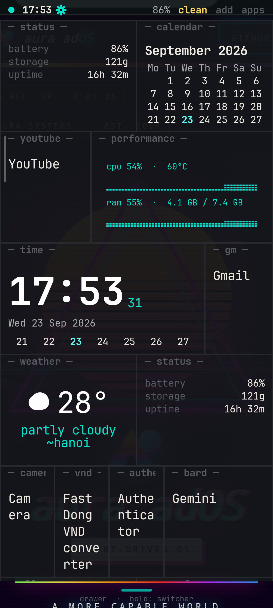
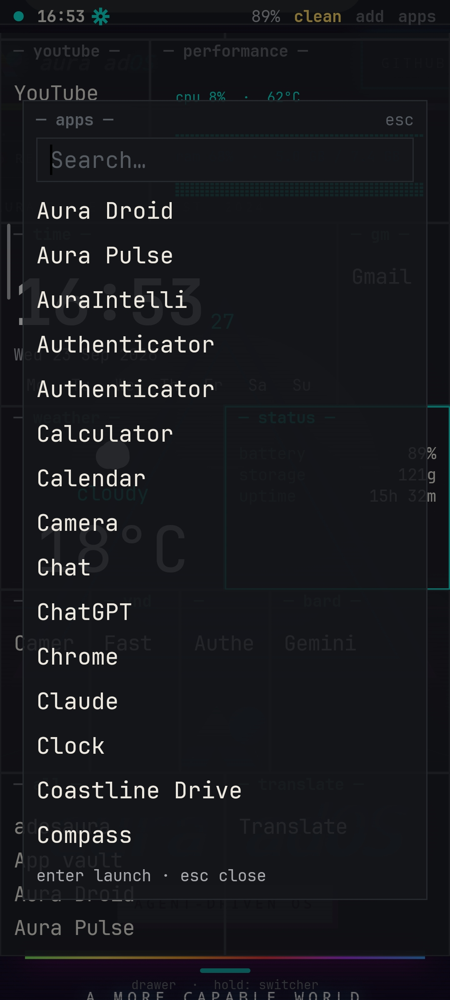
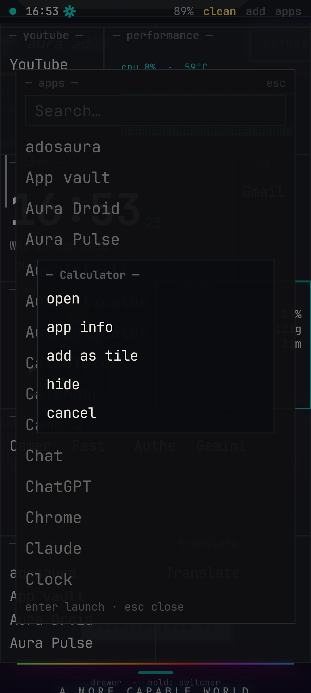
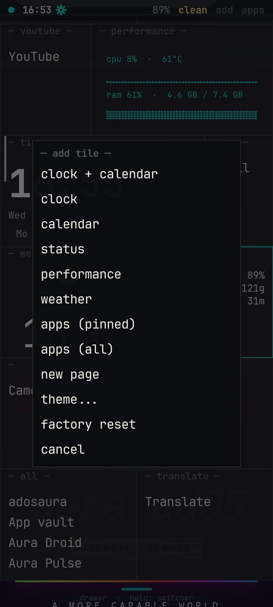
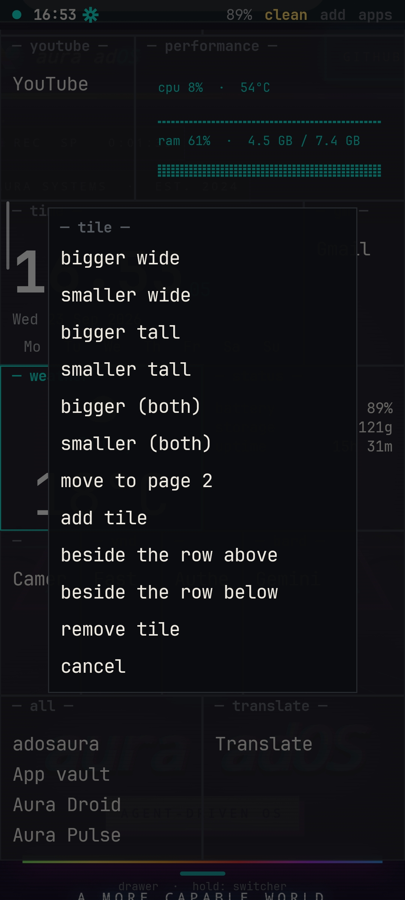

# adosaura

> A launcher for the Redmi Note 12 Pro 4G that looks like Aura OS: near-black
> purplerain, one monospace font, square text-only tiles, no icons anywhere.

Home screen as a tiling desktop. Tiles are resizable, pages are swipeable, and
the app drawer is a searchable list of names fed by a file you can edit over
`adb`. Everything is text.

    ┌────────────────────────────────────────────┐
    │ ●○   15:03                    87%  add  apps│  ← the launcher's own strip
    ├──────────────┬─────────────┬────────────────┤
    │─ status ─    │─ calendar ─ │─ clock ─       │  ← three tiles across the top
    ├──────────────┴──────┬──────┴────────────────┤
    │─ pinned ─           │─ time ─               │
    │ Chrome              │ 15  03                │
    │ Telegram            │ 22 Sep 2026           │
    │ Termux              │ Mo Tu We Th Fr Sa Su  │
    ├─────────────────────┤ 21 22 23 24 25 26 27  │  ← four slots down the middle,
    │─ all ─              │ 28 29 30              │    the clock + calendar is tall
    │ Amber               ├───────────────────────┤
    │ Aurora Store        │─ all ─                │
    └─────────────────────┴───────────────────────┘

## Screenshots

Redmi Note 12 Pro 4G, HyperOS 1.0.

| home | drawer | app menu | add tile | tile menu |
| --- | --- | --- | --- | --- |
|  |  |  |  |  |

## Quick start

```sh
scripts/bootstrap-toolchain.sh   # JDK 17 + Android SDK + gradle, user-space
scripts/deploy.sh                # build, test, install onto the phone
```

No `sudo`, nothing outside `~/android-toolchain` and `~/.gradle`. The deploy
script also grants the four things the launcher needs and prints anything it
could not grant.

On the phone: enable **Developer options** (tap the OS version seven times),
then **USB debugging** — or **Wireless debugging** and `adb pair`.

## The two files

Everything the launcher shows comes from `/sdcard/adosaura/`. Both are plain
text, hot-reloaded while the app runs, and editable from a file manager or with
`adb push`. Bad input is skipped with a notice in the status strip — a broken
file can never brick the home screen.

### `apps.conf` — the drawer

```ini
# <package> | <display name> | <group>[,<group>...]
com.android.chrome        | Chrome        | all,pinned
com.termux                | Termux        | all,dev
org.telegram.messenger    | Telegram      | all,social
```

- the display name and the groups are optional
- `#` starts a comment anywhere; blank lines are ignored
- a duplicate package keeps the first entry and reports the later one
- **missing file** → the launcher writes one listing every launchable app
- **a newly installed app** is appended, marked `# added by adosaura`
- **an uninstalled app deletes its own line** — no ghost rows left dimmed to rot
  in the drawer or in an `apps:` tile. Checked on every reload, so it also
  catches an uninstall that happened while the launcher was not running
- a line you delete stays deleted — nothing is re-added behind your back

An app that is installed but has no launcher activity (Digital Wellbeing,
keyboard plugins) keeps its line: it is yours, it is installed, and the row's
long-press menu still reaches its info screen. Only a real uninstall removes a
row. The purge checks its own splice before writing and refuses to save a
result that does not add up, so a detection bug can never cost you the file.

### `layout.conf` — the tiles

```ini
# <page> <zone:top|main> <type>[:<arg>] <weight> [span]
0 top  stats        1
0 top  calendar     1
0 top  clock        1

0 main apps:pinned  1
0 main clockcal     2
0 main apps:all     1
```

| field | meaning |
| --- | --- |
| `page` | 0-based page; pages exist implicitly up to the highest one |
| `zone` | `top` = the horizontal row across the top · `main` = the column below |
| `type` | `clock`, `calendar`, `clockcal`, `apps:<group>`, `stats`, `perf`, `weather`, and the animated `analog`, `battery`, `matrix` |
| `weight` | share of the zone's axis. In `main` it also spans slots, so `2` is the tall middle tile |
| `span` | optional multiplier on weight (`1 span 2` = `2 weight`) |

Unknown types render as `? type` so a typo is visible instead of silently
eating a slot.

Any tile can carry its own style after the numbers, in any order:

```ini
0 0 clock   1 1 bg=0f1f3a fg=ffd466 size=140
0 1 weather 1 1 fg=cyan
```

| token | meaning |
| --- | --- |
| `bg=` | the tile's background: a theme colour name or six hex digits (no `#` — it starts a comment) |
| `fg=` | every text colour in the tile; the dimmer shades become faded versions of it |
| `size=` | text size in percent, 60–200 |

Theme names (`red`, `accent`, …) follow a theme change; hex stays fixed. On the
phone: long-press a tile title → `style…` → tile colour, text colour, text
bigger / smaller, reset.

The animated tiles, `analog` (a sweeping second hand), `battery` (the charge as
liquid, with bubbles while charging) and `matrix` (falling glyphs), drop to one
frame a second in eco mode and stop completely when the launcher is off screen.

### `look` — weather location override

The weather tile uses the phone's coarse location (granted by
`scripts/adb-grants.sh`), then this file, then IP geolocation. The place it
used is printed under the temperature. To pin it:

```ini
lat=44.79
lon=20.45
place=belgrade
```

### `saves/` — saved home screens

`add` → `saves...` → `+ save this screen` copies `layout.conf`, `theme`,
`look` and `apps.conf` into `saves/home-N/`. Tap a save to load it, overwrite
it or delete it. Loading first copies the current screen to `saves/previous/`,
so a load can always be undone.

The same menu has bundled presets to start from. A preset replaces the tiles,
theme and pane style, but keeps your apps.conf and weather location:

| preset | what it is |
| --- | --- |
| `minimal` | a big clock + calendar and your pinned apps, mono, solid |
| `dashboard` | status, performance, clock, weather, pinned and all apps on one screen |
| `focus` | clock and weather over your wallpaper, pinned apps below, nord |
| `two-pages` | widgets on page 1, every app on page 2, purplerain |
| `retro` | amber CRT: the `crt` theme plus `crt=on` scanlines, vignette and a rolling band |

`crt=on` in `look` works with any theme; `theme...` → `crt effect` toggles it.

`theme...` → `bg: photo from gallery…` opens the system photo picker (no
storage permission needed). The picture is scaled to the screen, copied to
`background.jpg` next to the other files, and `look` gets `wallpaper=photo`.
A save includes the photo.

When battery saver is on, or the battery is at 20% or less and unplugged, the
launcher goes eco: the performance tile polls every 5 s instead of every
second, the CRT band stops rolling, and `clean` reads `clean·eco`. Each save is a plain folder: rename it, copy it
to another phone, or edit it like the live files.

## Using it

| | |
| --- | --- |
| `add` (top right) | add a tile, or start a new page |
| `add` → `saves...` | save this home screen, or load / overwrite / delete a saved one |
| `apps` (top right) | the app drawer |
| drag a tile's `↘` | resize it along its zone's axis |
| long-press a tile title | bigger / smaller / style (colours, text size) / move to page / remove |
| long-press an app row | open / app info / hide |
| swipe left and right | move between pages |
| `Home` again | collapse to page 0 and close the drawer |
| Esc | close the drawer |
| tap the yellow notice | reload both config files |
| tap `clean` | stop every user app's background processes, drop caches, show MB freed |
| hold `clean` | optimize menu: clean, battery saver, what drains the battery |

## Permissions

All four are granted by `scripts/adb-grants.sh`; none need tapping through
MIUI.

| permission | why |
| --- | --- |
| `QUERY_ALL_PACKAGES` | resolve every app's real label and launch it |
| `MANAGE_EXTERNAL_STORAGE` | read `/sdcard/adosaura/*.conf` |
| battery exemption | keep hot reload alive through doze |
| autostart | HyperOS kills launchers without it |

If access to `/sdcard` is missing the launcher says so in the status strip and
falls back to the bundled default layout.

## Known limitation, stated plainly

HyperOS disables **full-screen gestures for third-party launchers**, so while
adosaura is the home screen the phone uses 3-button navigation. That is a
Xiaomi limitation. Recents, the notification shade and the system status bar
also cannot be replaced without root — see [docs/DESIGN.md](docs/DESIGN.md) for
what Phase 2 (no root) covers and what Phase 3 (rooted) would add.

## Layout of this repo

    scripts/bootstrap-toolchain.sh   toolchain into ~/android-toolchain, no sudo
    scripts/deploy.sh                build + test + install + grant
    scripts/adb-grants.sh            the HyperOS grants on their own
    app/src/main/java/dev/aura/adosaura/
        LauncherActivity.kt   the HOME activity and the page/tile layout
        LauncherModel.kt      all state, and every write back to the files
        config/               parsers + file IO — pure Kotlin, unit tested
        tiles/  drawer/  status/  ui/
    app/src/test/java/         90 tests over the file formats, tile styles, labels, saves and presets
    docs/DESIGN.md             the design system and the phase boundaries

## Licence

MIT for adosaura. JetBrains Mono is bundled under the SIL OFL 1.1 — see
`THIRD-PARTY-NOTICES.md` and `app/src/main/assets/licenses/JetBrainsMono-OFL.txt`.
